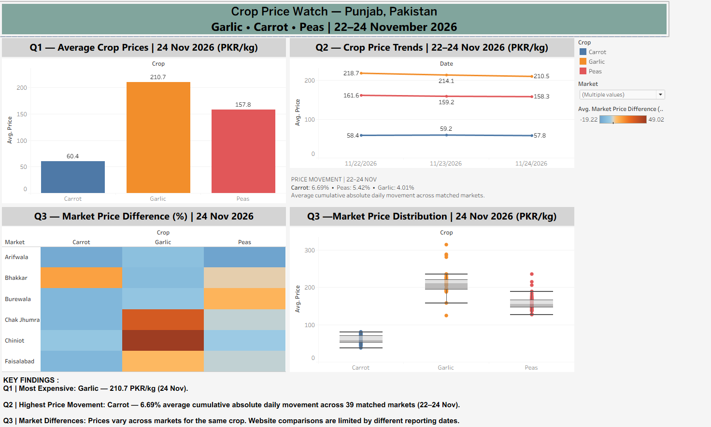

# Crop Price Watch 

**A three-day agricultural price-monitoring and Tableau analytics project**

Python web scraping · Data cleaning · Market comparisons · Tableau dashboard

## Overview

Crop Price Watch analyzes public wholesale quotations for **Garlic (Local), Carrot, and Peas** across markets in **Punjab, Pakistan**. Prices were collected on **22–24 November 2026** from [MandiOye](https://mandioye.com/amis/commodity/garlic-local) and [PakDataHub](https://pakdatahub.com/mandi/garlic_local). The study asks:

1. **Q1:** Which crop is the most expensive?
2. **Q2:** Which crop's price changes most over three days?
3. **Q3:** Do different markets report different prices for the same crop?

## Main findings

| Question | Finding | Method |
| --- | --- | --- |
| **Q1** | **Garlic: 210.70 PKR/kg** — highest average price on 24 Nov | Mean price across available markets |
| **Q2** | **Carrot: 6.69%** — largest average cumulative *absolute* daily percentage movement | 39 matching Carrot markets across all three dates |
| **Q3** | Prices differ between markets for the same crop | Market-level percentage differences and price distribution |

**Q2 comparison:** Carrot **6.69%** (39 crop–markets), Peas **5.42%** (38), Garlic **4.01%** (34). The percentage is the average *sum of absolute consecutive-day percentage changes*, not a net increase or decrease.

## Data at a glance

- **2** public websites
- **3** crops, **3** collection days
- **1,231** raw observations from 3 timestamped runs (354 + 447 + 430)
- **524** cleaned observations dated 22–24 Nov 2026
- **111** matched crop–market pairs with prices on all 3 dates (**333** records for Q2)
- All analyzed prices normalized to **PKR/kg**

**Important:** `date` is the website's published price date; `scraped_at` is collection time. Some PakDataHub prices had earlier published dates. Source observations can overlap.

## Dashboard

The Tableau workbook contains four visualizations:

- **Q1 — Bar Chart:** average crop prices on 24 Nov.
- **Q2 — Line Chart:** daily average price trends for markets matched across 22–24 Nov; movement percentages are reported separately.
- **Q3 — Heatmap:** a market price relative to the same crop's same-day average, in %.
- **Q3 — Box Plot:** price spread, medians, and outliers across markets.

The dashboard includes a Tableau calculated field, date/market filters, and key findings.

### Dashboard preview



**Interactive workbook:** [Download Dashboard.twbx](Dashboard.twbx) to open locally in Tableau Desktop. The PNG above is a static preview; Tableau filters and tooltips are available in the workbook.

## Repository structure

```text
Crop-price-watch/
├── README.md
├── NOTES.md
├── requirements.txt
├── scraper.py
├── Dashboard.png
├── Dashboard.twbx
├── notebooks/
│   └── Crop_Price_Watch_Organized.ipynb
├── data/
│   ├── clean_data.csv
│   ├── dashboard_data.csv
│   └── q2_matched_markets.csv
└── snapshots/
    ├── full_snapshot_2026-11-22_19-49-37.csv
    ├── full_snapshot_2026-11-23_18-20-36.csv
    └── full_snapshot_2026-11-24_13-41-46.csv
```

## How to run

Install the Python dependencies:

```bash
pip install -r requirements.txt
```

Run the standalone scraper for a **new** timestamped snapshot:

```bash
python scraper.py
```

It checks `robots.txt`, uses polite delays and retries, follows MandiOye pagination, and outputs a raw CSV under `snapshots/`. **Running it now produces current observations, not historical 2026 snapshots.** Retain the original collection files for reproducibility.

Alternatively, open `notebooks/Crop_Price_Watch_Organized.ipynb` in Google Colab. Its analysis cells work from the three existing CSV snapshots, using direct file upload/download rather than a Google Drive mount.

## Cleaning and methodology

Prices from MandiOye's AMIS **Fair Quotation Price (FQP)** were converted from **PKR/100kg** to PKR/kg; PakDataHub prices were already expressed per kg. Cleaning validates data types and positive prices, filters the target published dates, normalizes market names, and deduplicates on **crop + normalized market + published date**, with MandiOye preferred for overlapping observations.

The Q2 metric for each matched crop–market pair is:

```text
100 × ( |P23 − P22| / P22 + |P24 − P23| / P23 )
```

We then average that metric by crop.

## Limitations

- Different source publication dates prevent a reliable, like-for-like **three-day website comparison**; Q3 therefore emphasizes **market comparisons**.
- Some market labels are spelling variants of the same market.
- Wholesale quotations are not guaranteed selling offers; transport costs and fees are not included.
- HTML structure and robots.txt rules can change, so future scraper runs should be checked.

For full methodology, field data types, validation decisions, and transparent AI-assistance disclosure, see **[NOTES.md](NOTES.md)**.

## Tools

**Python** · Requests · BeautifulSoup · Pandas · Google Colab · **Tableau**

*Academic project — MSc Data Science, Riphah International University (2026).*
